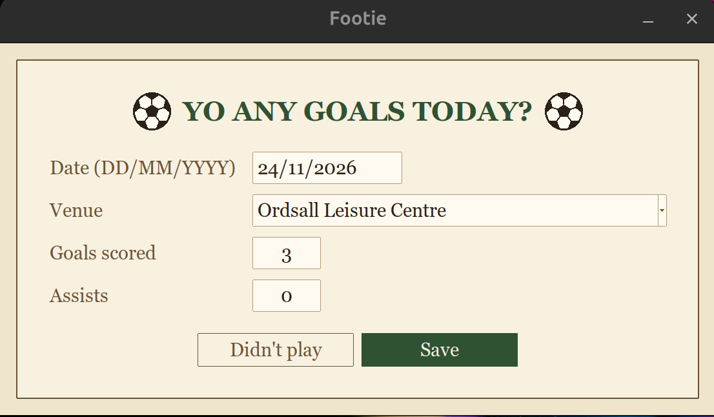

# Footie – football stats recorder

Footie records your goals, assists and venue after every match. The data lives in a local SQLite database, and Footie can write a stats table into any README (for example your GitHub profile repo) and commit and push it for you. A daily reminder opens the entry window at 22:00 if you have not recorded a match that day.

Works on Linux, macOS and Windows. Requires Python 3.9+ with Tkinter.



## Install

Install with [pipx](https://pipx.pypa.io/):

```bash
pipx install git+https://github.com/abdursujon/footie.git
```

Your installation starts with an empty database. No one else's match data is included.

If Tkinter is missing:

- Debian/Ubuntu: `sudo apt install python3-tk`
- Fedora: `sudo dnf install python3-tkinter`
- macOS (Homebrew Python): `brew install python-tk`
- Windows: included with the python.org installer

## Quick start

```bash
footie change-profile https://footyaddicts.com/players/<your-name>   # optional, shown as a link in your stats
footie set-stats-readme ~/my-stats-repo/README.md                    # where your stats table is published
footie install-schedule                                              # daily reminder at 22:00
footie add                                                           # open the entry window
footie                                                               # show your stats
```

## Recording a match

`footie add` opens the entry window with date, venue, goals and assists. The venue box lists every venue already in your database, most played first, and preselects your last venue. Type a new name to add a venue.

`footie` on its own shows your totals and match table.

Without the window, pass any option to `footie add`; missing ones default to today, no venue, 0 goals and 0 assists:

```bash
footie add --venue "Powerleague - Manchester Central" --goals 2 --assists 1
footie add --date 21/11/2026 --venue "Oasis Academy Media City" --goals 0 --assists 1
footie list        # every match with its ID
footie delete 7    # delete match ID 7
```

Every save is a separate match, so several matches on the same day are all counted. To correct a match, delete it by ID and add it again.

## Publishing stats to a README

```bash
footie set-stats-readme PATH [--git push|commit|off]
```

Footie writes the stats table between these markers and leaves the rest of the file untouched:

```markdown
<!-- footie-stats:start -->
<!-- footie-stats:end -->
```

If the markers are missing, a `## My Football Stats` section is appended. After every save Footie commits only that README and pushes it (`--git push`, the default), commits without pushing (`--git commit`), or skips git (`--git off`). Pushing from the reminder needs non-interactive git authentication, for example an SSH key without a passphrase or a credential helper.

`footie publish` rewrites the README and commits and pushes it on demand.

## Daily reminder

```bash
footie install-schedule                        # scheduler detected from this OS, 22:00
footie install-schedule --time 21:30           # different time
footie install-schedule --os linux             # systemd user timer
footie install-schedule --os linux-cron        # crontab entry
footie install-schedule --os mac               # launchd agent
footie install-schedule --os windows           # Task Scheduler
footie show-schedule
footie remove-schedule
```

Every scheduler runs `footie --if-no-record-today`, which opens the window only when today has no match recorded.

## Importing existing matches

```bash
footie import-csv matches.csv                    # skips rows identical to a recorded match
footie import-csv matches.csv --keep-duplicates  # imports every row
```

The CSV needs the header `date,venue,goals,assists`, with dates as `DD/MM/YYYY`.

## Other commands

| Command | Description |
| --- | --- |
| `footie` or `footie stats` | Print totals and the match table |
| `footie venues` | List known venues |
| `footie profile` | Show the saved profile URL |
| `footie where` | Show the database location and settings |
| `footie --help` | All commands and options |

## Where data is stored

| OS | Database |
| --- | --- |
| Linux | `~/.local/share/footie/footie.db` (or `$XDG_DATA_HOME/footie`) |
| macOS | `~/Library/Application Support/footie/footie.db` |
| Windows | `%APPDATA%\footie\footie.db` |

Set `FOOTIE_DATA_DIR` to use a different folder.

## Development

```bash
git clone https://github.com/abdursujon/footie.git
cd footie
python3 -m venv .venv && . .venv/bin/activate
pip install -e ".[test]"
pytest
```

## My Football Stats

<!-- footie-stats:start -->
Footy Addicts profile: [https://footyaddicts.com/players/sujon](https://footyaddicts.com/players/sujon)

Total Match Played = 15 | Total Goals = 13 | Total Assists = 7

| Venue                                  | Date                 | Goals | Assists |
| -------------------------------------- | -------------------- | ----- | ------- |
| Powerleague - Manchester Central       | 11 Aug 2026 Tuesday  | 0     | 0       |
| Powerleague - Manchester Central       | 18 Aug 2026 Tuesday  | 1     | 0       |
| Powerleague - Manchester Central       | 08 Sep 2026 Tuesday  | 0     | 0       |
| Trinity Sports Centre                  | 12 Sep 2026 Saturday | 0     | 0       |
| Platt Lane (ManCity Academy)           | 13 Sep 2026 Sunday   | 1     | 1       |
| Powerleague - Manchester Central       | 17 Sep 2026 Thursday | 3     | 2       |
| Powerleague - Manchester Central       | 24 Sep 2026 Thursday | 0     | 0       |
| Powerleague Manchester Nicholls        | 26 Sep 2026 Saturday | 2     | 1       |
| Powerleague - Manchester Central       | 29 Oct 2026 Thursday | 1     | 1       |
| Platt Lane (ManCity Academy)           | 01 Nov 2026 Sunday   | 1     | 0       |
| Oasis Academy Media City               | 14 Nov 2026 Saturday | 0     | 1       |
| Denmark Road Sports Centre, Manchester | 17 Nov 2026 Tuesday  | 0     | 0       |
| Powerleague - Manchester Central       | 19 Nov 2026 Thursday | 0     | 0       |
| Oasis Academy Media City               | 21 Nov 2026 Saturday | 1     | 1       |
| Ordsall Leisure Centre                 | 23 Nov 2026 Monday   | 3     | 0       |
<!-- footie-stats:end -->
